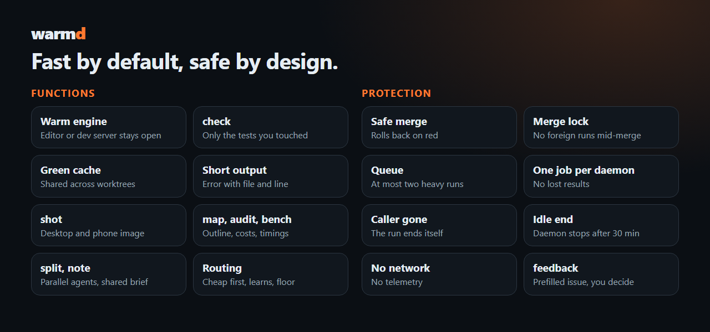

<div align="center">


# warmd

**Your coding agent waits less and reads less. Unity tests in 3 seconds instead of 56, and 41 bytes of output instead of 33,323.**

```bash
curl -fsSL https://raw.githubusercontent.com/Vyrenbusiness-source/warmd-fewer-tokens-faster-agents/main/install.sh | bash
cd your-project && warmd init && warmd check
```

[](https://github.com/Vyrenbusiness-source/warmd-fewer-tokens-faster-agents/stargazers)
[](https://github.com/Vyrenbusiness-source/warmd-fewer-tokens-faster-agents/actions/workflows/ci.yml)
[](LICENSE)


<sub>Illustrative session. Timings come from [the measurements](docs/MEASURED.md).</sub>

<table>
<tr>
<td align="center" width="25%"><h3>95% faster</h3>one Unity test class<br><sub>56 s → 3 s, large HDRP project</sub></td>
<td align="center" width="25%"><h3>99% fewer tokens</h3>per green Unity test run<br><sub>33 KB log → 41 bytes</sub></td>
<td align="center" width="25%"><h3>0.4 s</h3>repeat run, code unchanged<br><sub>green results are cached</sub></td>
<td align="center" width="25%"><h3>19% cheaper</h3>same task with and without warmd<br><sub>real A/B, 2 runs, <a href="docs/ab.md">docs/ab.md</a></sub></td>
</tr>
</table>

**Saves you tokens or time? [Star it](https://github.com/Vyrenbusiness-source/warmd-fewer-tokens-faster-agents/stargazers).** One click, and others find it.

**[Features](#features) · [Why](#why) · [Install](#install) · [What you get](#what-you-get) · [Measured](#measured) · [Docs](#docs) · [Safety](#safety)**

</div>

A headless daemon and one-command CLI for games, websites and ordinary programs. It finds your stack on its own and works with Claude Code, Codex, Cursor and anything that can run a shell command.

**Everything stays readable.** Only the output of builds and tests is shortened, never your code. On red you get the error lines with file and line, and the full log stays in `.warmd/run/last.log`.

## Features

Every number below is measured. Sources: [docs/MEASURED.md](docs/MEASURED.md), [docs/PROOF.md](docs/PROOF.md), [docs/ab.md](docs/ab.md), `tests/`. Your numbers will differ, `warmd bench` measures your own project.

| Command | What it does | Measured |
|---|---|---|
| `warmd check` | Builds, then runs only the tests that mention what you changed. Green runs are cached | Unity test class 56 s → 3 s, repeat 0.4 s |
| `warmd gain` | Reads your Claude Code transcripts and prints tokens and dollars per session. Offline | A/B on one task: 100,805 → 92,791 tokens, 0.0294 → 0.0238 usd per run ([ab.md](docs/ab.md)) |
| `warmd init --slim` | Gives agents without a `tools` line the cheapest useful tool set | Start tokens 15,334 → 3,762, Bash adds back 1,867 (commit `b04fe81`) |
| `warmd layout` | Layout problems as text lines at desktop and phone width, no screenshot | Test: `tests/layout.sh` |
| `warmd shot` | Desktop and 390 px phone screenshot, sized to cost few tokens | 2 screenshots in 1.3 s |
| `warmd map <file>` | Outline with line numbers instead of the whole file | Test: `tests/run.sh` |
| `warmd watch` | Runs in the background and ends when an agent stalls or the batch is over | Test: `tests/run.sh` |
| `warmd handoff` | Context filling up: saves state and prints the line for a fresh agent | Test: `tests/run.sh` |
| `warmd perf` | Compares load time and bundle size to a stored baseline, refuses a regression over 5% | Test: `tests/perf.sh` |
| `warmd audit` | Shows what your agents really pay for, biggest cost first | Test: `tests/run.sh` |
| `warmd report` | Cost per model tier and what escalation wasted | Test: `tests/ledger.sh` |
| `warmd update` | Fetches the newest version, only when you run it | Only runs on request, nothing is fetched otherwise |

**Faster inner loop (branch `warmd/speed2`, commit `17d6f02`).** The code hash behind the cache needs fewer process forks. With 40 changed files it takes 115 ms instead of 662 ms per call (10-call average). With 1 changed file it stays at about 100 ms. A green-cache hit no longer waits for a slot in the queue.

## Why

An AI agent working on a game spends most of its time waiting for the engine, and every wait gets paid for again in context. A 300-line build log costs tokens on each following turn. A second run of the same test costs the same minute again.

| One Unity test run | Plain test command | warmd |
|---|---|---|
| Time, one test class, large project | 56 s | 3 s |
| Time, same code run again | 3 s | 0.4 s |
| Output the agent reads | 33,323 bytes | 41 bytes |

The 56 s baseline comes from a private project. Method and raw output: [PROOF.md](docs/PROOF.md).

## Every advantage, one sentence

### Speed


- **Warm engine.** The Unity editor or the web dev server stays open between runs, so no call pays the start again.
- **`warmd check`.** Builds, then runs only the tests that mention what you changed.
- **Green cache.** A passing run stays passing until the code changes, across all worktrees. Red is never cached.
- **`warmd bench`.** Measures cold, warm and cached timings on your own project, so you can check every number here.

### Tokens


- **Short output.** One line on success. On failure only the error lines, with file and line where the stack allows it. These figures are per test run, not per session.
- **`warmd shot`.** A desktop and a real 390 px phone screenshot in about 1.3 seconds, sized to cost few tokens.
- **`warmd map <file>`.** An outline with line numbers instead of reading the whole file.
- **`warmd audit`.** Shows what your agents really pay for, biggest cost first.

### Many agents


- **`warmd split`.** Turns a task list into worktrees, model tiers and one-line prompts. Haiku only reads, edits start at Sonnet.
- **Shared brief.** All agents of a batch read one short file. `warmd note "..."` adds a finding, so the next agent skips that search.
- **`warmd escalate`.** After a failure the same task goes to the next tier, with the earlier commits as context. Areas that needed it twice start higher next time.
- **Routing you control.** `floor=mid` or `floor=top` sets the lowest tier. The aliases `haiku`, `sonnet` and `opus` follow new releases, so nothing needs changing when a model ships.
- **`warmd finish`.** Pushes and prints a one-line report from git and the last run.
- **`warmd merge`.** Runs the checks on the merged result and rolls back on red.

### Safe by design



- **Queue.** At most two heavy Unity runs per machine, so six agents do not take the PC down.
- **One job per daemon.** A second caller waits instead of overwriting the first result.
- **Merge lock.** While a merge runs in a checkout, other runs there are refused with a clear message.
- **Caller gone.** A run whose agent or shell has died ends itself and frees the queue.
- **Idle end.** An idle daemon stops after 30 minutes.
- **`warmd feedback`.** Prints a prefilled GitHub issue with your bench numbers. Nothing is sent, you decide.

## Install

```bash
curl -fsSL https://raw.githubusercontent.com/Vyrenbusiness-source/warmd-fewer-tokens-faster-agents/main/install.sh | bash
cd your-project
warmd init
warmd check
```

`warmd init` installs what your stack needs, adds agent definitions to `.claude/agents`, and adds a short block to `CLAUDE.md` or `AGENTS.md`. Your agent picks it up from there.

Needs bash and git. On Windows, use Git Bash. Pin a version with `WARMD_VERSION_TAG=v0.2.0 bash install.sh`.

## What you get

warmd detects the project from its files. There is nothing to configure.

| Stack | Kept warm | `build` | `test` | `shot` |
|---|---|---|---|---|
| **Unity** | Headless editor | `dotnet`, no Unity needed | EditMode and PlayMode through the Test Runner API | Your own capture method |
| **Godot** | Nothing by default, it starts in 0.2 s | Parses every script | Built-in runner, GUT or gdUnit4 | One frame of a scene |
| **Web** | Dev server | Typecheck and lint | Vitest, Jest or your script | Desktop and phone width |
| **Rust, Go, Python, .NET** | Nothing to keep warm | `cargo check`, `go build`, `ruff`, `dotnet` | Native test runner | |

Every stack gets the same four things: affected tests, a green cache, short output, and a queue of at most two heavy Unity runs per machine. For web work, `warmd shot` takes a desktop and a real 390 px phone screenshot in about 1.3 seconds, sized to cost few tokens.

Also built in: [cheap models first](docs/AGENTS.md), parallel agents in separate worktrees, a shared brief, safe merges.

## Fits your setup

| Your situation | What you get |
|---|---|
| Large Unity project | 95% faster test runs |
| Godot project | Fresh engine in 0.2 s, plus the cache, affected tests, short output and agent splitting |
| You already have filtered logs and test tiers | Point `build=` and `test=` at your tools, warmd adds the cache, the queue and worktrees around them |
| Tokens go to images, long docs and agent context | `warmd audit` shows those costs first, `warmd map` and small screenshots cut them |
| Quality comes first | Set `floor=mid` or `floor=top`. No task runs below that tier |

The cheap tier only ever reads. Anything that edits a file starts at the mid tier.

## Measured

Windows 10, Unity 6000.4, Godot 4.7, Chrome. Your numbers will differ.

| Run | Before | With warmd |
|---|---|---|
| Unity, one test class, large HDRP project | 56 s | 3 s |
| Unity, full PlayMode test, same project | 54 s | 26 s |
| Same test with `--speed 8` | 54 s | 8 s |
| Unity, repeat with unchanged code | 3 s | 0.4 s |
| Godot, one test | | 0.9 s |
| Web, 2 screenshots with a warm Vite server | | 1.3 s |

Numbers are per run. Do not trust them, run them: `warmd bench` measures your own project, and the [public CI run](https://github.com/Vyrenbusiness-source/warmd-fewer-tokens-faster-agents/actions/workflows/ci.yml) measures a fresh one on every push. More tables and notes: [MEASURED.md](docs/MEASURED.md), raw output: [PROOF.md](docs/PROOF.md).

## Docs

- [Commands and configuration](docs/COMMANDS.md)
- [Cheap models first and parallel agents](docs/AGENTS.md)
- [Measured](docs/MEASURED.md) and [Proof](docs/PROOF.md)
- [FAQ](docs/FAQ.md)

## Safety

warmd is about 2,263 lines of bash plus one C# and one GDScript file. You can read it in one sitting.

- **No network.** It sends nothing anywhere, there is no telemetry. Only `warmd finish` talks to the outside, and only with `git push` to your own remote.
- **What it writes.** `.warmd/` (ignored by git), a cache in `~/.cache/warmd`. `warmd init` adds `.claude/agents`, a short block in `CLAUDE.md` or `AGENTS.md`, and the engine file: `Assets/Editor/Warmd` for Unity, `addons/warmd` for Godot.
- **What it can undo.** `warmd merge` only starts from a clean checkout. On red it runs `git reset --hard HEAD`, which is safe there because the tree was clean before.
- **What it kills.** Only processes it started. An editor you opened by hand is never touched, warmd refuses to run instead.
- **Pin a version.** `WARMD_VERSION_TAG=v0.2.0 bash install.sh`, or clone and read it first.


## Contributing

See [CONTRIBUTING.md](CONTRIBUTING.md). Short version: run `bash tests/run.sh`, it needs no engine.

## License

MIT
