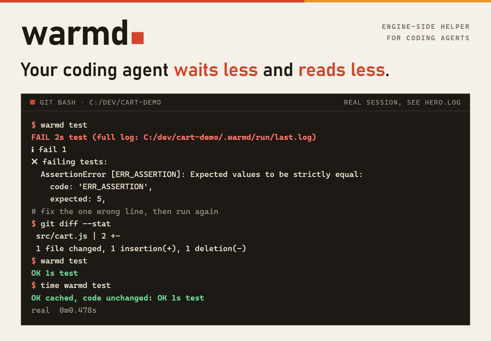
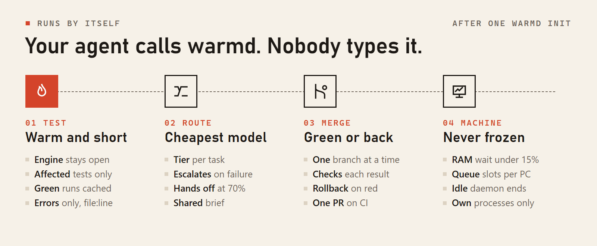
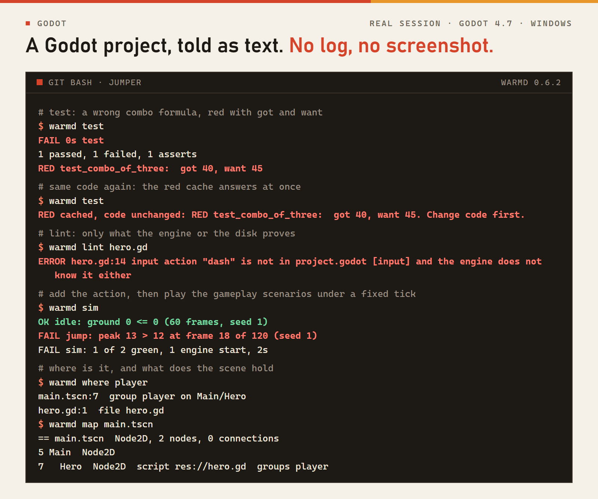
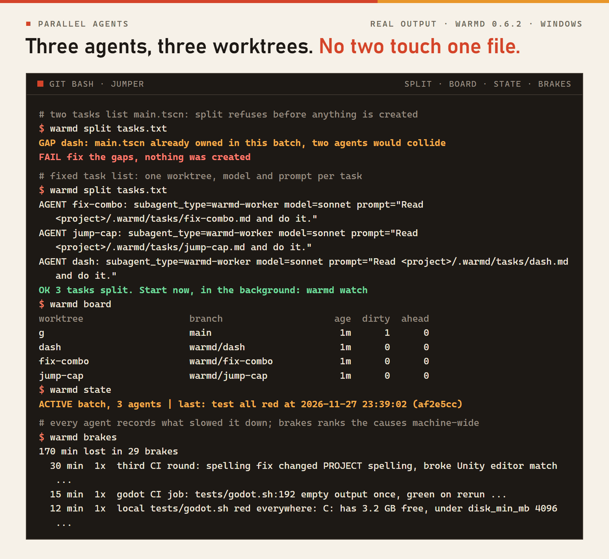
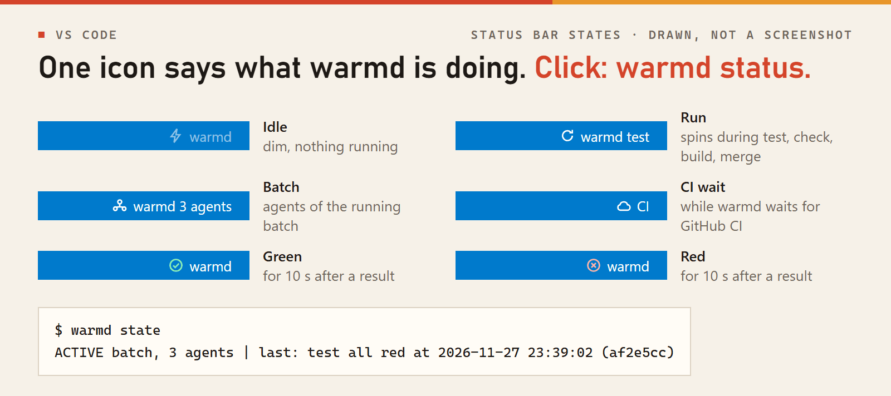
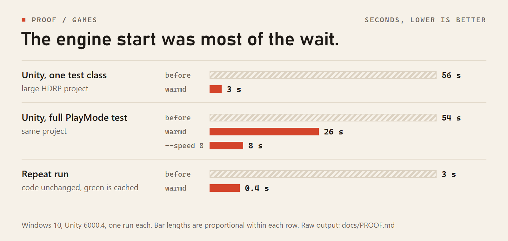
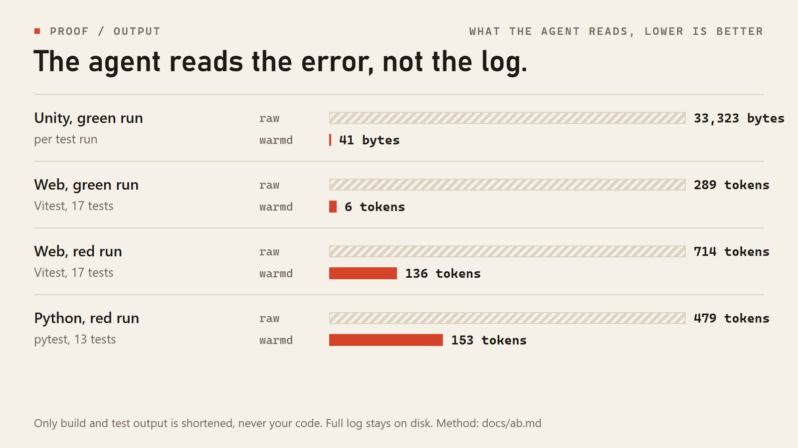

<div align="center">

<picture>
  <source media="(prefers-color-scheme: dark)" srcset="docs/assets/hero-dark.png">
  
</picture>

**Your coding agent waits less and reads less.**<br>
warmd keeps the engine warm, skips tests whose code did not change and hands the agent only the error.<br>
<sub>Unity · Godot · Web · Python · Rust · Go · .NET, on Windows, for Claude Code, Codex and Cursor</sub>

<table>
<tr>
<td align="center" width="33%"><h3>56 s → 3 s</h3>one Unity test class<br><sub><a href="docs/MEASURED.md">warm headless editor</a></sub></td>
<td align="center" width="33%"><h3>33,323 → 41</h3>bytes the agent reads per green run<br><sub><a href="docs/PROOF.md#tokens">Unity log vs. warmd</a></sub></td>
<td align="center" width="33%"><h3>26% fewer</h3>tokens, 27% lower cost<br><sub><a href="docs/ab.md">agent A/B, 5 of 5 fixed per arm</a></sub></td>
</tr>
</table>

```text
/plugin marketplace add Vyrenbusiness-source/warmd
/plugin install warmd@warmd
```

<sub>Inside Claude Code, then restart it. Codex, Cursor or your own terminal: one line, see [Install](#install).</sub>

[What it does](#what-it-does) · [Godot](#godot) · [Agents](#parallel-agents) · [Proof](#proof) · [Install](#install) · [All commands](docs/COMMANDS.md) · [FAQ](docs/FAQ.md)

[](https://github.com/Vyrenbusiness-source/warmd/actions/workflows/ci.yml)
[](https://github.com/Vyrenbusiness-source/warmd/releases/latest)
[](LICENSE)
[](https://github.com/Vyrenbusiness-source/warmd)

</div>

## The problem

A coding agent spends most of a test run waiting for the engine to start.
Then it pays tokens to read a log it mostly ignores.

What the agent reads after one Unity test run, real output from [PROOF.md](docs/PROOF.md#unity):

| | Without warmd | With warmd |
|---|---|---|
| **Green** | 33,323 bytes of editor log, about 8,300 tokens, after a cold editor start | `OK 3s test`<br>`8 passed, 0 failed, 0 skipped` |
| **Red** | The same log with the failure somewhere inside | `RED Adds: ScoreTests.cs:2 Expected: 5    But was:  -1` |
| **Repeat, code unchanged** | The whole run again | `OK cached, code unchanged: 1 passed, 0 failed, 0 skipped` in 0.4 s |

## What it does

After `warmd init` your agent calls warmd through its instructions and hooks. Nobody types a warmd command.
Each line below is one command or feature; [docs/COMMANDS.md](docs/COMMANDS.md) has every option.

<picture>
  <source media="(prefers-color-scheme: dark)" srcset="docs/assets/auto-dark.png">
  
</picture>

### Tests: warm, cached, error only

| | |
|---|---|
| `warmd build` | Fastest compile or typecheck for the detected stack. A green compile is cached like a test run. |
| `warmd test [filter]` | Green is one line. Red is the test, `file:line`, expected and actual. |
| `warmd check` | Build, then only the tests the change touches: a real import graph for JS and TS, Python, C# and GDScript. |
| **Green cache** | A passing result holds until the code changes, across worktrees. |
| **Red cache** | A failing run on unchanged code answers at once: `Change code first.` Timeouts and crashes are never kept. |
| **Engine in the key** | Engine version, binary and project settings are part of the cache key. A new engine never reuses an old result. |
| **Warm engine** | The Unity editor runs headless and stays open, the web dev server too. `warmd stop` ends it. |
| **Unity** | EditMode and PlayMode through the Test Runner API, time lapse with `--speed N`, `--play`, `--edit`, `--window`, `--sound`. |
| `warmd run -- <cmd>` | Any command: up to 20 lines pass, longer output becomes one OK or FAIL line with the error lines. |
| `warmd status` · `warmd bench` | What was detected and what is warm. Cold, warm and cached timings on your own project. |

### Godot

The truth about a Godot project as a few lines of text: no log to scroll, no screenshot to read.

<picture>
  <source media="(prefers-color-scheme: dark)" srcset="docs/assets/godot-dark.png">
   12 at frame 18; warmd where and warmd map answer with file:line">
</picture>

| | |
|---|---|
| **No false green** | A test that stops on a script error or ran no assert is red. So is a runner that prints `SCRIPT ERROR` and exits 0. |
| **Compile with `file:line`** | Strict typing (`untyped_declaration`, `unsafe_*` at level 2) is red. Every changed `.tscn` and `.tres` is loaded: a dead path is red. |
| **One engine start** | All test runners in one engine, random order from a printed seed. Built-in runner, GUT or gdUnit4. |
| **Leaks** | A test that leaves orphan nodes is red with the count. |
| `warmd lint` | Red only when the engine or the disk proves it: unknown input action, missing `res://` path, wrong case, layer outside 1-32. |
| `warmd sim` | Gameplay scenarios headless under a fixed tick, one line each: `FAIL jump: peak 13 > 12 at frame 18 of 120`. |
| `warmd sim --record` | Play the scene once; every input per tick becomes a replayable scenario a worker can fix. |
| `warmd where <term>` | At most 5 `file:line` places from scripts, scenes, input actions, autoloads and groups, then what changed. |
| `warmd map scene.tscn` | Scene outline: nodes, types, scripts, groups, signals as `from -> to method`. |
| `warmd peek <scene>` | Plays the scene headless and prints the node tree as text instead of a screenshot. |
| `warmd shot --golden` | Shot against this machine's reference: `SAME` or `DIFF 3.2% in region x,y,w,h`. |
| `warmd package` | Export smoke: exports the first preset, starts the release build and fails on a crash or script error. |
| **Budgets at merge** | Texture size, draw calls, memory and node count per scene, checked in the merge gate. |
| `warmd nightly` | Once a night without cache: `MISMATCH` when the cache lied, `FLAKY` when a test flips, `GAP` when the graph missed a file. |
| `warmd mutate` | Flips one operator per changed line. A line no test notices is `SURVIVED file:line`. GDScript, sh, Python, JS and TS. |
| `warmd doctor` | Unversioned `.uid` or `.import` files, `.godot/` not ignored, engine not the pinned version. |

Setup: `warmd init` once, it adds `addons/warmd`.

### Parallel agents

Cheap models do the work, a stronger one reviews, and the base branch stays green.

<picture>
  <source media="(prefers-color-scheme: dark)" srcset="docs/assets/agents-dark.png">
  
</picture>

| | |
|---|---|
| `warmd route <goal>` | Cheapest fitting tier: reading on `haiku`, edits on `sonnet`, hard areas on `opus`. Routing only learns upward. |
| `warmd models` | One model per role: producer, worker, qa, reviewer, merge, scout. The reviewer is never the author's model. |
| `warmd split <tasks.txt>` | One worktree, model and one-line prompt per task. Two tasks on one file or scene never run at once. |
| `warmd note` | One finding goes into the brief every agent of the batch reads. Nothing is searched twice. |
| `warmd escalate` | A real failure moves the task one tier up, with its commits as context. |
| `warmd handoff` | Past 70% of the budget or 60 tool calls: commit, and a fresh agent continues. |
| `warmd finish` | Records tokens and outcome, pushes, prints a one-line report. |
| `warmd watch` · `warmd board` | Background watch that ends when an agent stalls; all worktrees at a glance. |
| `warmd merge` | Branches merge one at a time, the checks run on each result, red is rolled back. |
| `warmd ship` · `warmd ci` | One pull request for the batch, waits for CI with an ETA, stops at the first red job, merges on green. |
| `warmd drop` · `warmd batch-done` · `warmd batch-resume` | Cancel one task, end the batch, or rebuild the batch from its open tasks and worktrees. |

### Machine and cost

| | |
|---|---|
| **RAM wait** | A heavy start queues while less than 15% of RAM is free. One heavy slot per 4 cores and 8 GB. |
| **Own processes only** | An editor you opened by hand is never touched. An idle daemon ends after 30 minutes. |
| `warmd brake` · `warmd brakes` | Agents record what slowed them down; `brakes` ranks the causes by minutes lost. |
| `warmd audit` | What your agents pay for on every turn, biggest first, including MCP servers that load upfront. |
| `warmd gain` · `warmd report` | Tokens and dollars per session from the transcripts; cost per tier and what escalation wasted. |
| `warmd init --slim` | Gives project agents without a tools line the cheapest useful set: fewer start tokens per subagent. |
| `warmd disk` · `warmd leak` | Free space, old worktrees and their caches; kernel memory lost per process start on Windows. |
| **Resume after reboot** | When a PC that loses memory per process start has too little RAM left for any run, warmd can restart it (only when you allow it) and Claude Code picks the handoff up again after sign-in. |
| `warmd doctor` · `warmd update` · `warmd feedback` | What is missing; the newest version, only when you run it; a prefilled issue with your bench numbers. |

### Web and UI

| | |
|---|---|
| `warmd shot [url]` | Desktop and 390 px phone screenshot, sized to cost few tokens. |
| `warmd layout [url]` | Layout problems as text lines, no screenshot. |
| `warmd perf` | Load time and bundle size against a stored baseline; a regression over 5% is red. |
| `warmd map [file]` | Repo map by import rank, or one file outline with line numbers. |

### See it in VS Code

<picture>
  <source media="(prefers-color-scheme: dark)" srcset="docs/assets/vscode-dark.png">
  
</picture>

`warmd state` prints in one line what warmd does here; the extension in `vscode/` shows it in the status bar.
Install: `(cd vscode && npx @vscode/vsce package --skip-license) && code --install-extension vscode/warmd-*.vsix`.

## Proof

Real runs on Windows 10, nothing estimated. The [public CI](https://github.com/Vyrenbusiness-source/warmd/actions/workflows/ci.yml) measures a fresh project on every push.

<picture>
  <source media="(prefers-color-scheme: dark)" srcset="docs/assets/speed-dark.png">
  
</picture>

<picture>
  <source media="(prefers-color-scheme: dark)" srcset="docs/assets/tokens-dark.png">
  
</picture>

| Agent fixing one bug, 5 runs per arm | Tokens | Cost | Fixed |
|---|---|---|---|
| Web, Vite and Vitest | **26% fewer** | 27% lower | 5 of 5 in both arms |
| Python, pytest | 7% fewer, within the spread | 11% lower | 5 of 5 in both arms |

Task time is equal within the spread in both areas: the gain on small projects is tokens and cost, on game engines it is time. Method and raw tables: [docs/ab.md](docs/ab.md), raw output: [docs/PROOF.md](docs/PROOF.md), game numbers: [docs/MEASURED.md](docs/MEASURED.md).

## Install

Claude Code, as a plugin. It brings the hooks, the agent definitions and the `warmd` command, nothing to run in your project:

```text
/plugin marketplace add Vyrenbusiness-source/warmd
/plugin install warmd@warmd
```

For Codex, Cursor or your own terminal, install the command. Git Bash:

```bash
curl -fsSL https://raw.githubusercontent.com/Vyrenbusiness-source/warmd/main/install.sh | bash
```

PowerShell, which also installs Git for Windows if it is missing:

```powershell
irm https://raw.githubusercontent.com/Vyrenbusiness-source/warmd/main/install.ps1 | iex
```

Then run `warmd init` once in your project. warmd detects the stack from its files, there is nothing to configure.
With the plugin, `warmd init` is optional: it adds the block to `CLAUDE.md` and the agent definitions to the project.
`warmd init --no-hooks` removes the hooks again.

| Stack | Kept warm | Tests |
|---|---|---|
| **Unity** | Headless editor | EditMode and PlayMode, Test Runner API |
| **Godot** | Nothing, one test in 0.9 s | Built-in runner, GUT or gdUnit4, red on script errors and zero asserts |
| **Web** | Dev server | Vitest, Jest or your script |
| **Rust, Go, Python, .NET** | Nothing | Native test runner |

<a id="safety"></a>
<details>
<summary><b>Safety: what it sends, writes, undoes and kills</b></summary>

About 7,000 lines of bash, one C# file, four small GDScript files and a PowerShell installer. You can read it in one sitting.

- **No telemetry.** It talks only to git remotes: it pushes finished branches to yours, and with a GitHub CI it uses `gh` to open the pull request, wait for the checks and merge. `warmd status` and `warmd doctor` check at most every 6 hours for a newer version with a `git fetch` of the warmd clone, `WARMD_UPDATE_CHECK=0` turns it off. A new version is installed only by `warmd update`, or by a `warmd ship --release` of warmd itself.
- **What it writes.** `.warmd/` (ignored by git), a cache in `~/.cache/warmd`. The setup adds `.claude/agents`, a short block in `CLAUDE.md` or `AGENTS.md`, and the engine file: `Assets/Editor/Warmd` for Unity, `addons/warmd` for Godot.
- **What it can undo.** A merge only starts from a clean checkout. On red it runs `git reset --hard HEAD`, which is safe there because the tree was clean before.
- **What it kills.** Only processes it started. An editor you opened by hand is never touched, warmd refuses to run instead.
- **Limits.** One job per daemon, a merge lock per checkout, a run whose caller died ends itself, the RAM wait lasts at most 30 minutes.
- **Pin a version.** Set `WARMD_VERSION_TAG` for the install, or clone and read it first.

</details>

## More

[Every command and setting](docs/COMMANDS.md) · [Cheap models and parallel agents](docs/AGENTS.md) · [A/B per area](docs/ab.md) · [Measured](docs/MEASURED.md) · [Proof](docs/PROOF.md) · [FAQ](docs/FAQ.md) · [Changelog](CHANGELOG.md) · [Contributing](CONTRIBUTING.md) · [Security](SECURITY.md) · [MIT license](LICENSE)

<sub>Saves you tokens or time? A star helps others find it.</sub>
