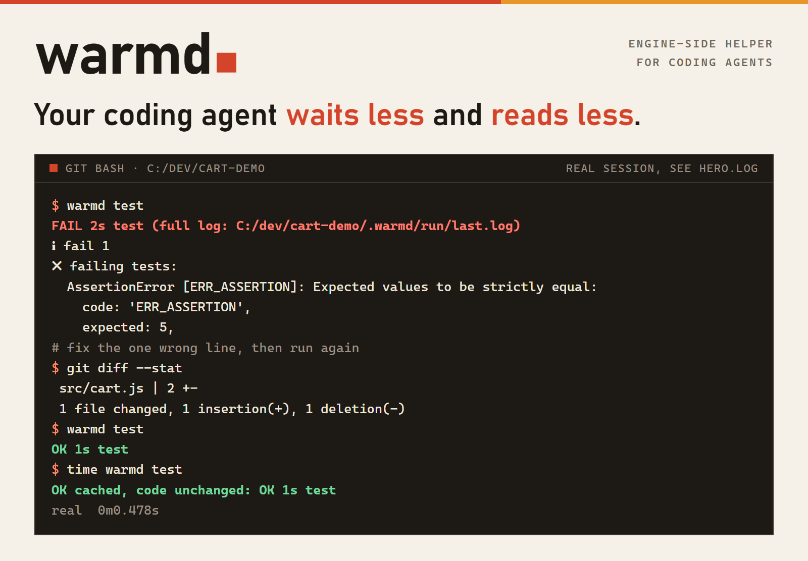
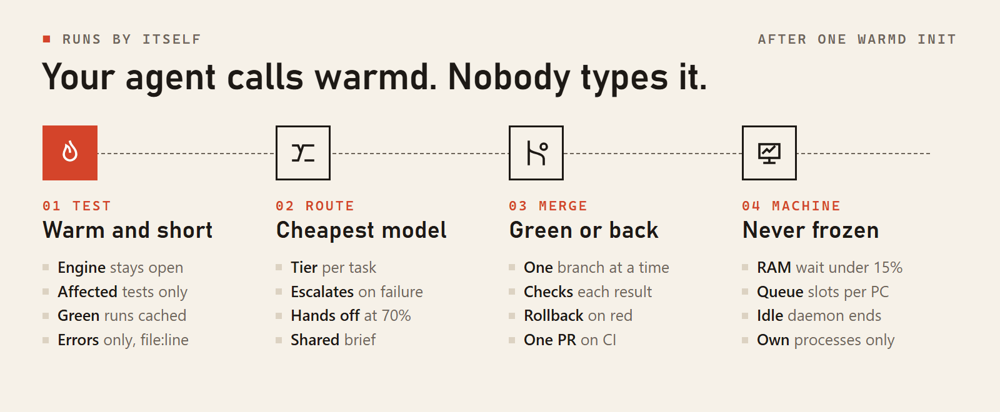
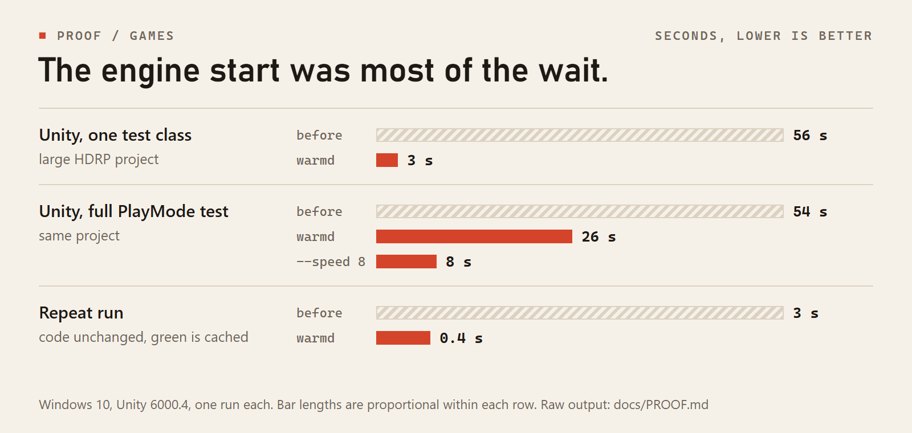
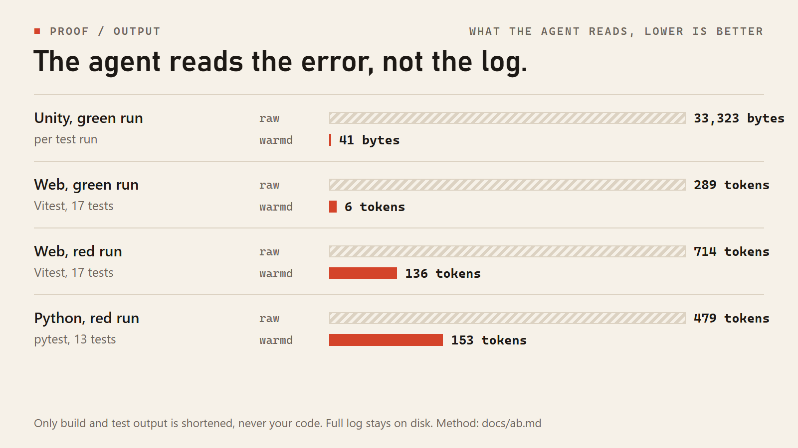

<div align="center">

<picture>
  <source media="(prefers-color-scheme: dark)" srcset="docs/assets/hero-dark.png">
  
</picture>

**Your coding agent waits less and reads less.**<br>
<sub>Unity · Godot · Web · Python · Rust · Go · .NET, on Windows, for Claude Code, Codex and Cursor</sub>

[Install](#install) · [Proof](#proof) · [Reference](docs/COMMANDS.md) · [FAQ](docs/FAQ.md)

[](https://github.com/Vyrenbusiness-source/warmd-fewer-tokens-faster-agents/actions/workflows/ci.yml)
[](https://github.com/Vyrenbusiness-source/warmd-fewer-tokens-faster-agents/releases/latest)
[](LICENSE)
[](https://github.com/Vyrenbusiness-source/warmd-fewer-tokens-faster-agents)

</div>

## The problem

A coding agent spends most of a test run waiting for the engine to start, then pays tokens to read a log it mostly ignores.
warmd keeps the engine warm, answers unchanged code from cache and hands the agent only the error.

## What runs by itself

After `warmd init` your agent calls warmd through its instructions and hooks. Nobody types a warmd command.

<picture>
  <source media="(prefers-color-scheme: dark)" srcset="docs/assets/auto-dark.png">
  
</picture>

| | |
|---|---|
| **01 Test** | **Warm engine:** the Unity editor runs headless and stays open, the web dev server too. **Affected tests:** a real import graph for JS and TS, Python, C# and GDScript, and `warmd check` takes the faster of full and selective. **Green cache:** a passing result holds until the code changes, across worktrees. **Error only:** green is one line, red is the test, `file:line`, expected and actual. |
| **02 Route** | **Cheapest tier:** reading starts on `haiku`, edits on `sonnet`, hard areas on `opus`. **Escalation:** a real failure moves the task one tier up with its commits as context. **Handoff:** past 70% of the budget or 60 tool calls an agent commits and a fresh one continues. **Shared brief:** one fact found by one agent is never searched again. |
| **03 Merge** | **One at a time:** pushed branches merge in the background and the project's checks run on each result. **Rollback:** red is reset, the base stays green. **CI:** with GitHub CI the branches go through one pull request, the wait prints an ETA and stops at the first red job. |
| **04 Machine** | **RAM wait:** a heavy start queues while less than 15% of RAM is free. **Queue:** one heavy slot per 4 cores and 8 GB. **Idle end:** a daemon stops after 30 minutes. **Own processes only:** an editor you opened by hand is never touched. |

Also: time lapse for Unity tests (`--speed N`), screenshots and layout problems as text, a performance baseline, repo maps and file outlines, lean subagent starts and real token cost per task. Every one is in the [reference](docs/COMMANDS.md).

## Proof

Real runs on Windows 10, nothing estimated. The [public CI](https://github.com/Vyrenbusiness-source/warmd-fewer-tokens-faster-agents/actions/workflows/ci.yml) measures a fresh project on every push.

<picture>
  <source media="(prefers-color-scheme: dark)" srcset="docs/assets/speed-dark.png">
  
</picture>

<picture>
  <source media="(prefers-color-scheme: dark)" srcset="docs/assets/tokens-dark.png">
  
</picture>

| Agent fixing one bug, 5 runs per arm | Tokens | Cost | Fixed |
|---|---|---|---|
| Web, Vite and Vitest | **26% fewer** | 27% lower | 5 of 5 in both arms |
| Python, pytest | 7% fewer, within the spread | 11% lower | 5 of 5 in both arms |

Task time is equal within the spread in both areas: the gain on small projects is tokens and cost, on game engines it is time. Method and raw tables: [docs/ab.md](docs/ab.md), raw output: [docs/PROOF.md](docs/PROOF.md), game numbers: [docs/MEASURED.md](docs/MEASURED.md).

## Install

Git Bash:

```bash
curl -fsSL https://raw.githubusercontent.com/Vyrenbusiness-source/warmd-fewer-tokens-faster-agents/main/install.sh | bash
```

PowerShell, which also installs Git for Windows if it is missing:

```powershell
irm https://raw.githubusercontent.com/Vyrenbusiness-source/warmd-fewer-tokens-faster-agents/main/install.ps1 | iex
```

Then run `warmd init` once in your project. warmd detects the stack from its files, there is nothing to configure.

| Stack | Kept warm | Tests |
|---|---|---|
| **Unity** | Headless editor | EditMode and PlayMode, Test Runner API |
| **Godot** | Nothing, one test in 0.9 s | Built-in runner, GUT or gdUnit4 |
| **Web** | Dev server | Vitest, Jest or your script |
| **Rust, Go, Python, .NET** | Nothing | Native test runner |

<details>
<summary><b>Safety: what it sends, writes, undoes and kills</b></summary>

About 4,100 lines of bash, one C# file, three small GDScript files and a PowerShell installer. You can read it in one sitting.

- **No telemetry.** It talks only to git remotes: it pushes finished branches to yours, and with a GitHub CI it uses `gh` to open the pull request, wait for the checks and merge. `warmd status` and `warmd doctor` check at most every 6 hours for a newer version with a `git fetch` of the warmd clone, `WARMD_UPDATE_CHECK=0` turns it off. A new version is installed only by `warmd update`, or by a `warmd ship --release` of warmd itself.
- **What it writes.** `.warmd/` (ignored by git), a cache in `~/.cache/warmd`. The setup adds `.claude/agents`, a short block in `CLAUDE.md` or `AGENTS.md`, and the engine file: `Assets/Editor/Warmd` for Unity, `addons/warmd` for Godot.
- **What it can undo.** A merge only starts from a clean checkout. On red it runs `git reset --hard HEAD`, which is safe there because the tree was clean before.
- **What it kills.** Only processes it started. An editor you opened by hand is never touched, warmd refuses to run instead.
- **Limits.** One job per daemon, a merge lock per checkout, a run whose caller died ends itself, the RAM wait lasts at most 30 minutes.
- **Pin a version.** Set `WARMD_VERSION_TAG` for the install, or clone and read it first.

</details>

## More

[Every command and setting](docs/COMMANDS.md) · [Cheap models and parallel agents](docs/AGENTS.md) · [A/B per area](docs/ab.md) · [Measured](docs/MEASURED.md) · [Proof](docs/PROOF.md) · [FAQ](docs/FAQ.md) · [Changelog](CHANGELOG.md) · [Contributing](CONTRIBUTING.md) · [Security](SECURITY.md) · [MIT license](LICENSE)

<sub>Saves you tokens or time? A star helps others find it.</sub>
