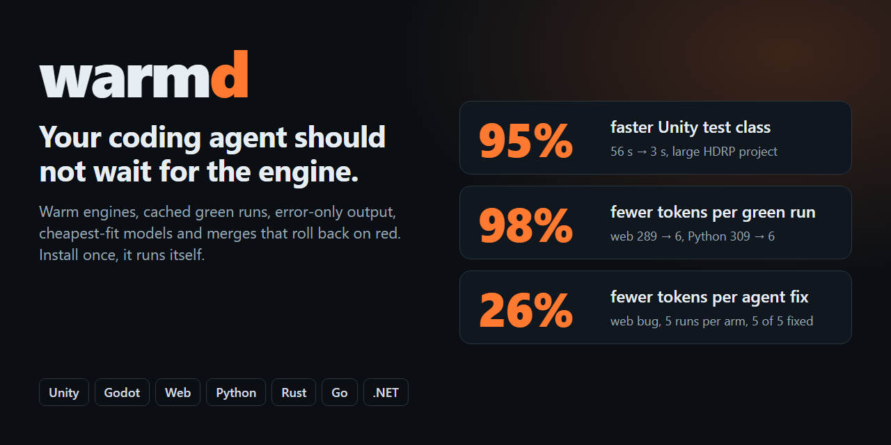
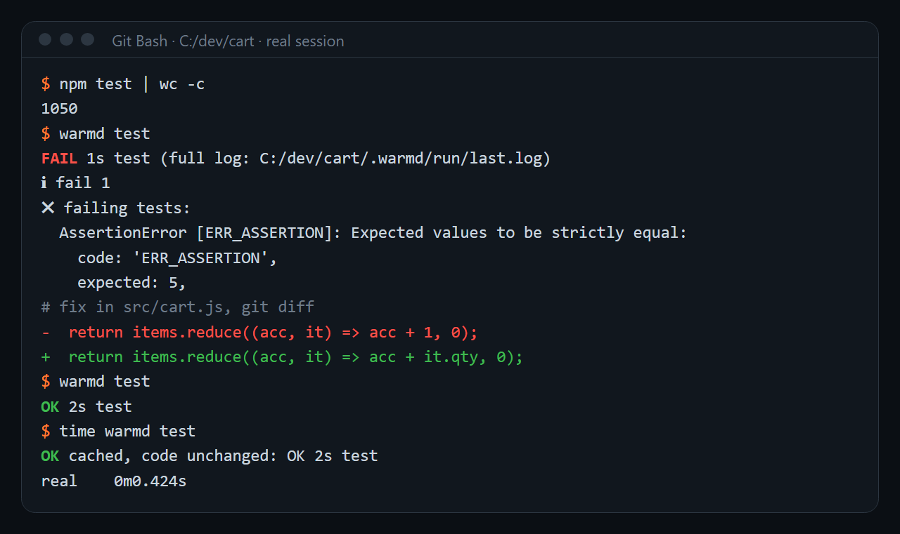
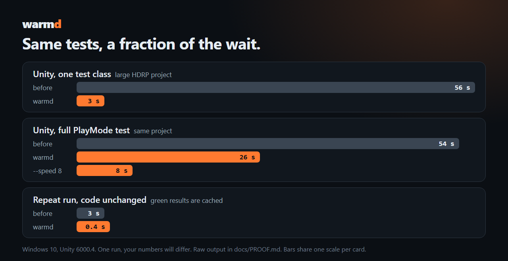
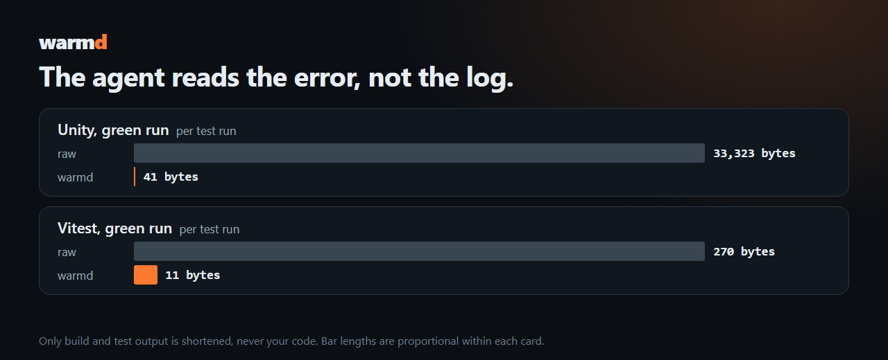
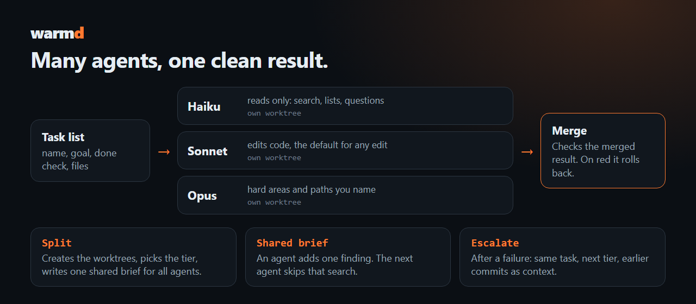

<div align="center">



# warmd

**Install once. After that warmd runs the slow parts for your coding agent, and you do nothing.**

For Windows, in Git Bash. [Install in one line](#install).

[](https://github.com/Vyrenbusiness-source/warmd-fewer-tokens-faster-agents/stargazers)
[](https://github.com/Vyrenbusiness-source/warmd-fewer-tokens-faster-agents/actions/workflows/ci.yml)
[](LICENSE)




<sub>Real session on Windows 10 in Git Bash, output unchanged. The project is <a href="tests/ab/sample">tests/ab/sample</a>.</sub>

<table>
<tr>
<td align="center" width="50%"><h3>95% faster</h3>one Unity test class<br><sub>56 s → 3 s, large HDRP project</sub></td>
<td align="center" width="50%"><h3>99% fewer tokens</h3>per green Unity test run<br><sub>33 KB log → 41 bytes</sub></td>
</tr>
<tr>
<td align="center" width="50%"><h3>0.4 s</h3>repeat run, code unchanged<br><sub>green results are cached</sub></td>
<td align="center" width="50%"><h3>19% cheaper</h3>same task with and without warmd<br><sub>real A/B, 2 runs, <a href="docs/ab.md">docs/ab.md</a></sub></td>
</tr>
</table>

**Saves you tokens or time? [Star it](https://github.com/Vyrenbusiness-source/warmd-fewer-tokens-faster-agents/stargazers).** One click, and others find it.

</div>

## What happens on its own

`warmd init` installs the engine side, agent definitions and a short instruction block in `CLAUDE.md` or `AGENTS.md`. Your agent reads it and calls warmd by itself. From then on:

1. The slow engine, such as the Unity editor or a dev server, stays open between runs.
2. A passing run stays passing until the code changes.
3. Only the tests that touch your change run.
4. Output shrinks to one line on success and the error lines on failure.
5. Each task goes to the cheapest model tier that fits it.
6. Larger work splits across parallel agents, each in its own worktree.
7. A watcher reports an agent whose worktree stopped changing.
8. Finished branches merge into the base branch, and a red result rolls back.
9. Real tokens and dollars are read from the session transcripts.
10. Each project agent starts with the cheapest tool set it needs.
11. Web pages get screenshots and a layout check in plain text.

Your code is never shortened. On red the full log stays in `.warmd/run/last.log`. Details for each step follow. People who want to run a step by hand find the syntax in the [reference](docs/COMMANDS.md).

## Runs itself

After the one-time install, hooks do the rest. A session that restarts or compacts picks up its batch where it was. When an agent finishes, its real token count is recorded and its branch is pushed. When the last agent of a batch is done, the finished branches are merged with rollback on red. Nothing to type.

## Warm engine

The engine stays open between runs, so no call pays the start again. Unity runs as a headless editor, a web project as a dev server, Godot starts fresh in 0.2 s.

**Measured:** one Unity test class takes 3 s instead of 56 s on a large HDRP project.



## Green cache

A passing run stays passing until the code changes, across all worktrees. Red is never cached.

**Measured:** a repeat run with unchanged code takes 0.4 s instead of 3 s. The hash behind the cache takes 115 ms instead of 662 ms with 40 changed files ([MEASURED.md](docs/MEASURED.md#code-hash-speed-code_key)).

## Affected tests only

After a change warmd builds, then runs only the tests that mention what changed.

**Measured:** Vitest runs the touched test in 1.9 s instead of 4 s for all.

## Short output

The agent reads one line when a run is green. When it is red it reads only the error lines, with file and line where the stack allows it.

**Measured:** 33,323 bytes become 41 bytes for a green Unity run. These figures are per test run, not per session.



## Cheap models first

Each task is routed to the cheapest tier that fits. The cheap tier only reads. Anything that edits a file starts at the mid tier. After a failure the same task moves up one tier with the earlier commits as context, and an area that needed it twice starts higher next time. A project can set its lowest tier.

The aliases `haiku`, `sonnet` and `opus` follow new releases, so nothing needs changing when a model ships.

## Parallel agents

A task list becomes worktrees, model tiers and one-line prompts. All agents of a batch read one short shared brief and add findings to it, so the next agent skips that search. When context fills up, the state is saved and a fresh agent continues.



## Stalled agents wake up

While a batch runs, warmd watches every worktree. An agent that has not moved for 5 minutes is caught: changed files, commits, a running test or build, or any process still working inside its worktree count as movement, so long test runs never raise a false alarm. A stalled agent gets one message with its state and next step, or hands over to a fresh agent.

## Safe merges

Finished branches merge one at a time into the base branch. The merged result runs the project's own checks. On red the merge is rolled back and the failing tests are named, so the base branch stays green. A merge starts only from a clean checkout.

## Real tokens and dollars

warmd reads the session transcripts on disk and prints tokens and dollars per session, and the cost per tier including what escalation wasted. Everything is offline, prices come from a table you can override.

**Measured:** the same small task with and without warmd, real A/B: 100,805 against 92,791 tokens and 0.0294 against 0.0238 USD per run. Two runs per arm, so this is a direction and not a proof ([docs/ab.md](docs/ab.md)).

## Cheaper agent start

Every subagent pays for its tools, instructions and plugins before its first step. warmd gives project agents without a tool list the cheapest useful set and shows what each source costs.

**Measured:** start tokens fall from 15,334 to 3,762. Adding `Bash` brings back 1,867. Per source: user plugins and hooks +3,184, `CLAUDE.md` +1,713, skills +1,261, one MCP server +244 ([MEASURED.md](docs/MEASURED.md#agent-start-cost-warmd-init---slim)).

## Web checks

A desktop and a real 390 px phone screenshot, sized to cost few tokens. Layout problems also come as plain text lines, such as a clipped text or two overlapping boxes, so no image is needed. A stored baseline of load time and bundle size refuses a regression above 5%.

**Measured:** two screenshots with a warm Vite server take 1.3 s.


## Limits that protect your machine

- **Queue.** At most two heavy Unity runs per machine, so six agents do not take the PC down.
- **One job per daemon.** A second caller waits instead of overwriting the first result.
- **Merge lock.** While a merge runs in a checkout, other runs there are refused with a clear message.
- **Caller gone.** A run whose agent or shell has died ends itself and frees the queue.
- **Idle end.** An idle daemon stops after 30 minutes.

## Install

```bash
curl -fsSL https://raw.githubusercontent.com/Vyrenbusiness-source/warmd-fewer-tokens-faster-agents/main/install.sh | bash
cd your-project
warmd init
```

warmd runs on Windows. Run the install in Git Bash, which also provides git. Pin a version with `WARMD_VERSION_TAG=v0.2.0 bash install.sh`.

## Supported projects

warmd detects the project from its files. There is nothing to configure.

| Stack | Kept warm | Tests | Screenshot |
|---|---|---|---|
| **Unity** | Headless editor | EditMode and PlayMode through the Test Runner API | Your own capture method |
| **Godot** | Nothing by default | Built-in runner, GUT or gdUnit4 | One frame of a scene |
| **Web** | Dev server | Vitest, Jest or your script | Desktop and phone width |
| **Rust, Go, Python, .NET** | Nothing to keep warm | Native test runner | |

## Measured

Windows 10, Unity 6000.4, Godot 4.7, Chrome. Your numbers will differ.

| Run | Before | With warmd |
|---|---|---|
| Unity, one test class, large HDRP project | 56 s | 3 s |
| Unity, full PlayMode test, same project | 54 s | 26 s |
| Same test with time lapse `--speed 8` | 54 s | 8 s |
| Unity, repeat with unchanged code | 3 s | 0.4 s |
| Godot, one test | | 0.9 s |
| Web, 2 screenshots with a warm Vite server | | 1.3 s |

Do not trust the numbers, run them. The [public CI run](https://github.com/Vyrenbusiness-source/warmd-fewer-tokens-faster-agents/actions/workflows/ci.yml) measures a fresh project on every push. More tables and the method: [MEASURED.md](docs/MEASURED.md). Raw output: [PROOF.md](docs/PROOF.md).

## Safety

warmd is about 3,200 lines of bash plus one C# file and three small GDScript files. You can read it in one sitting.

- **No network.** It sends nothing anywhere, there is no telemetry. Only the final report talks to the outside, and only with `git push` to your own remote.
- **What it writes.** `.warmd/` (ignored by git), a cache in `~/.cache/warmd`. The setup adds `.claude/agents`, a short block in `CLAUDE.md` or `AGENTS.md`, and the engine file: `Assets/Editor/Warmd` for Unity, `addons/warmd` for Godot.
- **What it can undo.** A merge only starts from a clean checkout. On red it runs `git reset --hard HEAD`, which is safe there because the tree was clean before.
- **What it kills.** Only processes it started. An editor you opened by hand is never touched, warmd refuses to run instead.
- **Pin a version.** `WARMD_VERSION_TAG=v0.2.0 bash install.sh`, or clone and read it first.

## More

[Reference for every command and setting](docs/COMMANDS.md) · [Cheap models and parallel agents](docs/AGENTS.md) · [Measured](docs/MEASURED.md) · [Proof](docs/PROOF.md) · [FAQ](docs/FAQ.md) · [Contributing](CONTRIBUTING.md) · MIT license
