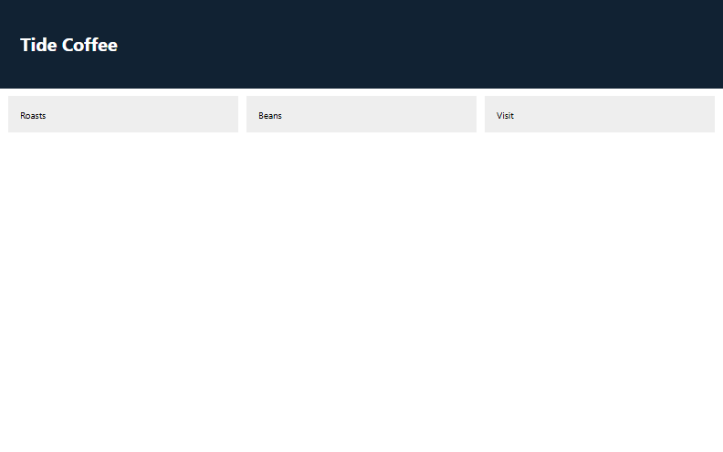
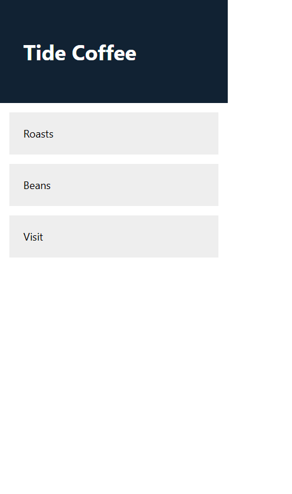

# Proof

Every number in the README comes from a real run. This page shows what was run and what came back, so you can check it or repeat it.

## Repeat it yourself

```bash
warmd bench            # cold, warm and cached on your project
warmd bench MyTests    # same, for one filter
```

The [CI workflow](https://github.com/Vyrenbusiness-source/warmd-fewer-tokens-faster-agents/actions/workflows/ci.yml) runs the self-tests on Windows, Linux and macOS, a real Godot, and a public benchmark. Open a run and look at the job summary of `proof`.

## Unity

Unity 6000.4.6f1 on Windows 10.

The 56 s and 54 s baselines come from a private game project with HDRP and a large scene, so that project cannot be published. Everything else below can be repeated on any Unity project.

One test class, warm editor, large project:

```console
$ warmd test TourRulesTests --edit
OK 3s test
8 passed, 0 failed, 0 skipped
```

Same run with no code change:

```console
$ warmd test ScoreTests --edit
OK cached, code unchanged: 1 passed, 0 failed, 0 skipped
```

Measured at 443 ms.

Time lapse on a full PlayMode test, large project:

```console
$ warmd test WholeTour --play
OK 26s test
1 passed, 0 failed, 0 skipped

$ warmd test WholeTour --play --speed 8
OK 8s test
1 passed, 0 failed, 0 skipped
```

A failing test on an empty project, after changing `a + b` to `a - b`:

```console
$ warmd check
OK 2s compile
compiled
(touched Edit: ScoreTests)
FAIL 1s test
0 passed, 1 failed, 0 skipped
RED Adds: ScoreTests.cs:2 Expected: 5    But was:  -1
```

A hung test names itself:

```console
$ WARMD_TIMEOUT=5 warmd test WholeTour --play
FAIL 5s test
timeout after 5s in phase testing
stuck in: WholeTour_FromTheBoardToTheBill_ByShip
```

Empty project, for an honest baseline: a fresh `-runTests` took 3 to 4 s, a warm run 1.3 s. On a project that small the daemon saves little. The gain comes from project size.

## Tokens

Output an agent has to read for one test run:

| Run | Raw output | warmd | Saved |
|---|---|---|---|
| Unity, green | 33,323 bytes of log | 41 bytes | 99.9% |
| Vitest, green | 270 bytes | 11 bytes | 96% |
| Vitest, one failure | 877 bytes | 490 bytes | 44% |

This covers test output only. A whole session also pays for reading code and for thinking, so total savings are smaller. Failures save less on purpose, the error is what the agent needs.

## Godot

Godot 4.7.2 on Windows. An engine start takes about 170 ms, so warmd runs it fresh instead of keeping a daemon. A warm daemon was slower here: 1.4 s against 0.9 s per run.

```console
$ warmd test
FAIL 0s test
1 passed, 1 failed
RED test_wrong: sum got 4, want 5
```

## Web

`warmd shot` on a plain page. Both images are real and untouched, taken in 1.2 s.

 

`warmd check` after changing one module runs only the test that mentions it:

```console
$ warmd check
OK 1s build
(touched: 1 test files)
FAIL 2s test
AssertionError: expected 'EUR4.00' to be '$4.00' // Object.is equality
```

## Agent splitting

The routing, worktrees, escalation and shared brief are covered by [tests/run.sh](../tests/run.sh). Token savings across a whole agent batch have not been measured yet. When they are, the numbers go here.
